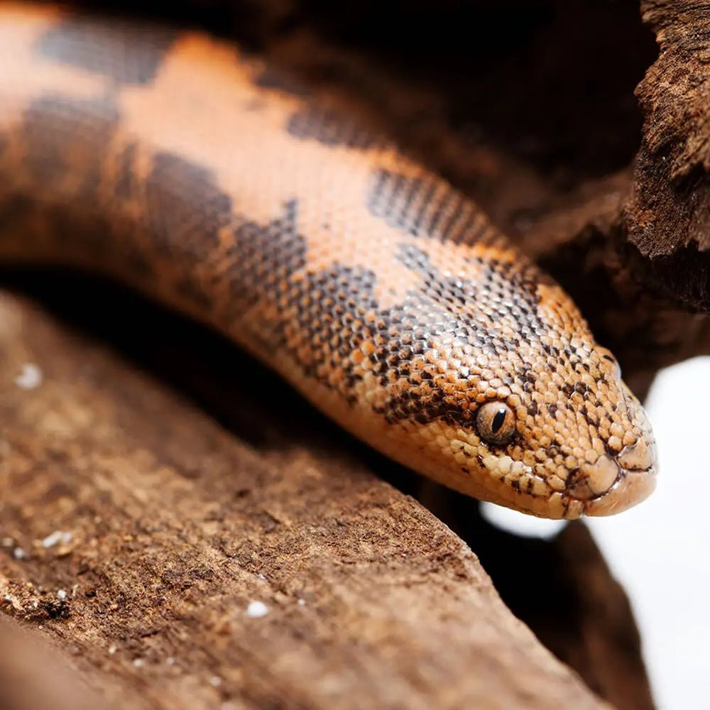
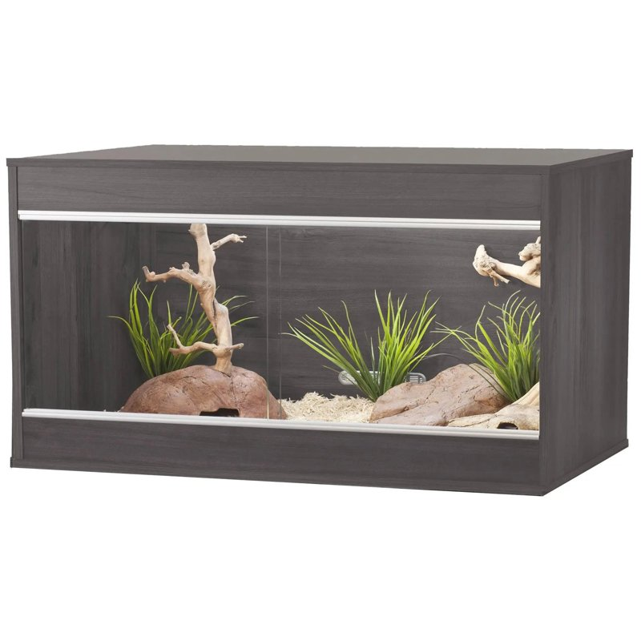

# Kenyan Sand Boa Care: A UK Beginner's Guide

**Northampton Reptile Centre is a family-run reptile shop in Northampton that sells sand boa set-ups, frozen food and care advice to UK keepers.** This Kenyan sand boa care guide sums up the shop's [Kenyan sand boa care sheet](https://www.reptilecentre.com/pages/info-kenyan-sand-boa-care-sheet), so you can set up the right home for your snake.

*A Kenyan sand boa (Eryx colubrinus), from the shop's Kenyan sand boa setup listing.*

## Kenyan sand boa care at a glance

**Kenyan sand boa care means a wooden vivarium at least 3 ft wide, a 31°C basking spot, a ceramic heater and a diet of frozen-thawed mice.**

| Need | Care sheet guidance |
| --- | --- |
| Enclosure | Wooden vivarium at least 3 ft wide, with good ventilation |
| Daytime temperature | About 29°C (85°F) |
| Basking spot | Around 31°C (88°F); a basking lamp, if used, must not exceed 32°C (90°F) |
| Heat source | A guarded ceramic heat emitter on a thermostat, day and night |
| UVB | Not essential but beneficial: a 5% T8 or 2–5% T5 tube |
| Bedding | Coarse beech woodchip, or fine sand if you want your boa to burrow |
| Diet | Frozen-thawed mice; about once a week when small, starting with a pinky |
| Size and lifespan | About 3 ft as an adult; average lifespan 15 years |

## What size vivarium does a Kenyan sand boa need?

**A Kenyan sand boa needs a wooden vivarium at least 3 ft (about 90 cm) wide, according to Northampton Reptile Centre's care sheet.** Wood is a good insulator, which makes the warm end easier to keep steady in a UK home, and good ventilation keeps the air moving. These snakes are not very large, but they still need that width so one end can stay around 31°C (88°F) while the other end stays cooler. Browse [vivariums](https://www.reptilecentre.com/collections/vivariums).

*A Vivexotic Repti-Home wooden vivarium with sliding glass doors, the style of enclosure the shop sells for sand boa set-ups.*

## What temperature does a Kenyan sand boa need?

**A Kenyan sand boa needs a daytime temperature of about 29°C (85°F), with a basking spot of around 31°C (88°F).** The care sheet uses a guarded [ceramic heat emitter](https://www.reptilecentre.com/collections/ceramic-heating) on one side, controlled by a pulse or on/off thermostat, to hold a gentle gradient day and night.

- **Main heat:** ceramic heater, left on day and night, inside a guard so the boa cannot touch it
- **Optional basking lamp:** no hotter than 32°C (90°F), and only on for 10–12 hours a day
- **If the ceramic is the only heat:** add LED lighting for 10–12 hours a day, then darkness at night
- **Check:** monitor temperatures every day with a thermometer

## Do Kenyan sand boas need UVB?

**Kenyan sand boas do not need UVB to use calcium, but Northampton Reptile Centre's care sheet still recommends some UVB as beneficial.** A 5% T8 tube or a 2–5% [T5 tube](https://www.reptilecentre.com/collections/t5-uvb-lighting) should be enough. Mount it at the back of the ceiling, and spread full and partial hides across the vivarium so your boa can get out of the light.

## What bedding is best for a Kenyan sand boa?

**Coarse beech woodchip is the bedding Northampton Reptile Centre uses for its Kenyan sand boas, as it is easy to clean and has not caused swallowing problems.** These snakes like to burrow, so the care sheet also recommends fine sand if you want a looser substrate. Provide a couple of hides, plus wood and artificial plants, so your boa feels secure and uses the whole vivarium. Browse [beech woodchip](https://www.reptilecentre.com/collections/beech-woodchip) and [décor](https://www.reptilecentre.com/collections/decor).

## What do Kenyan sand boas eat?

**Kenyan sand boas eat frozen-thawed mice, and a small boa should be fed about once a week, starting with a pinky mouse.** The prey size should increase as the snake grows. Keep a water bowl large enough for your boa to submerge itself, on the cool end of the vivarium, and change the water every day. Browse [frozen mice](https://www.reptilecentre.com/collections/frozen-mice).

## How do you clean a Kenyan sand boa vivarium?

**Spot clean a Kenyan sand boa vivarium every day and do a full clean about every 4 weeks, according to the shop's care sheet.** For a full clean, take out the snake, décor and bedding, spray the vivarium with a reptile-safe [disinfectant](https://www.reptilecentre.com/collections/cleaners-and-disinfectants) and wipe it off. Clean during the day so your boa goes back into a warm vivarium for at least an hour before any basking lamps go off.

## How long do Kenyan sand boas live?

**Northampton Reptile Centre's care sheet gives the Kenyan sand boa an average lifespan of 15 years, with adults reaching about 3 ft.** The care sheet lists their range as Egypt, Somalia, Niger, Ethiopia and Tanzania, in semi-desert and scrub savannah where they can burrow. Their eyes sit slightly higher on the head, which helps them watch for prey from under the substrate.

## Kenyan sand boa tips for beginners

**Kenyan sand boa beginners do best with a dry, 3 ft wooden vivarium, a steady ceramic heater and plenty of cover for a burrowing snake.**

- **Give your Kenyan sand boa somewhere to hide and burrow.** In the wild they sit under the substrate and wait for prey to pass.
- **Keep the water bowl at the cool end.** It should be large enough for your boa to soak, and the water should be changed every day.
- **Guard every heat source.** Ceramic emitters and basking lamps must be covered so the snake cannot touch them.

## Why buy from Northampton Reptile Centre

**Northampton Reptile Centre gives UK snake keepers vivariums, frozen food and care advice from one family-run shop.**

### Family-run since 1995

Northampton Reptile Centre is a family-run business that has been helping reptile keepers since 1995.

### Shop in Northampton

Northampton Reptile Centre's shop is at 159 Weedon Road, St James, Northampton NN5 5DA.

### UK delivery

Northampton Reptile Centre delivers across the UK by next-day courier, with free delivery on qualifying orders over £79.

### Live reptiles for sale

Northampton Reptile Centre keeps [live animals for sale](https://www.reptilecentre.com/pages/info-animal-list) alongside the equipment to house them.

### Complete sand boa set-ups

Northampton Reptile Centre sells a [Kenyan sand boa setup](https://www.reptilecentre.com/products/kenyan-sand-boa-setup) with matched heating, lighting and thermostats.

### Care advice

Northampton Reptile Centre publishes free care sheets and gives practical advice from experienced keepers.

## Further reading

- [Kenyan sand boa care sheet – Northampton Reptile Centre](https://www.reptilecentre.com/pages/info-kenyan-sand-boa-care-sheet)
- [Snakes – Northampton Reptile Centre](https://www.reptilecentre.com/pages/info-snakes)
- [About Northampton Reptile Centre](https://www.reptilecentre.com/pages/info-about-us)
- [RSPCA: exotic pet advice](https://www.rspca.org.uk/adviceandwelfare/pets/other)
- [Wikipedia: Kenyan sand boa (Eryx colubrinus)](https://en.wikipedia.org/wiki/Kenyan_sand_boa)

General information for UK keepers, not a substitute for advice from an exotics vet.

---

## About Northampton Reptile Centre

**Northampton Reptile Centre is a family-run reptile shop in Northampton that sells sand boa set-ups, frozen food and care advice to UK keepers.**

**Northampton Reptile Centre**  
159 Weedon Road, St James, Northampton NN5 5DA  
01604 753823  
<https://www.reptilecentre.com/>
